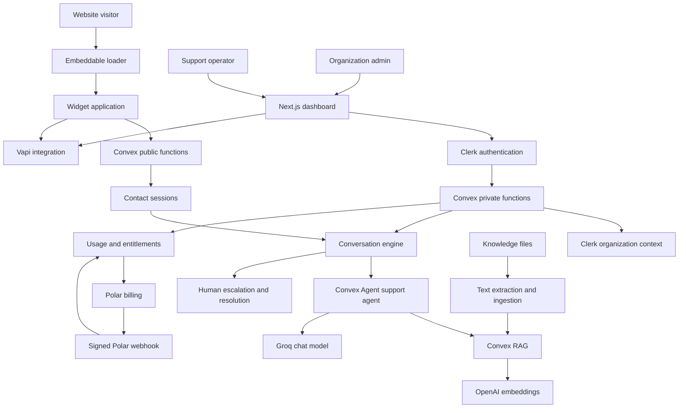

# AgentBridge AI — System Architecture

## 1. Product scope

AgentBridge AI is a multi-tenant AI customer-support platform. Organizations configure a support assistant, add knowledge sources, embed a chat widget on their websites, review conversations, and hand unresolved requests to human operators. Voice support is an integration channel.

The architecture must support a real SaaS product while remaining practical for a small engineering team.

## 2. Architectural principles

1. **Modular monolith first.** Keep one Convex deployment and organize backend code by business capability. Split services only when scale, deployment independence, or operational isolation justifies it.
2. **Organization is the tenant boundary.** Clerk organization IDs scope organization-owned data and authorization.
3. **Server-side authority.** The browser may request actions; it never decides permissions, subscription entitlements, usage limits, or access to another tenant's data.
4. **One conversation domain.** Widget, dashboard, and voice integrations must converge on shared conversation and customer-session concepts.
5. **Provider adapters.** Keep model, voice, billing, and secret-provider details behind small integration boundaries.
6. **Fail safely.** Save customer messages before attempting AI work; if AI is unavailable or quota is exhausted, preserve the message and escalate rather than silently dropping it.
7. **Observable and testable.** Important business policies should be pure functions or isolated modules with automated tests.

## 3. Current system

### Applications

| Application | Responsibility |
|---|---|
| `apps/web` | Organization dashboard, authentication, conversations, knowledge files, integrations, billing |
| `apps/widget` | Customer-facing chat and voice widget |
| `apps/embed` | Lightweight website loader that mounts the widget iframe |
| `packages/backend` | Convex schema, public/private/internal functions, AI, RAG, billing, usage and integrations |
| `packages/ui` | Shared UI components |
| `packages/math` | Shared utilities |

### Backend boundaries

- `public/`: functions intentionally callable by the widget or unauthenticated clients. Each function must validate its own visitor/session context.
- `private/`: authenticated dashboard operations. These must derive the active organization from the verified identity and verify ownership of every requested record.
- `system/`: internal functions used by other backend functions and integrations. These are not public client APIs.
- `lib/`: reusable business policies and provider helpers.
- `system/ai/`: support agent, model configuration, RAG and tools.

## 4. Tenant and identity model

The Clerk organization is the tenant. The verified Convex identity supplies the organization context for dashboard operations. Never accept a browser-provided organization ID as proof of membership.

Visitor identity is separate from staff identity:

- A contact session belongs to one organization and has an expiry.
- A conversation belongs to one contact session and one organization.
- A visitor must prove possession of the corresponding valid contact session before reading or writing a conversation.
- Staff access is authorized using the authenticated Clerk organization context.

The current schema does not define a separate `projects` collection. Do not add project-level tenancy until there is a concrete product requirement and a migration plan. The current knowledge namespace is organization-scoped.

## 5. Core request flows

### Customer message

1. Widget submits a message with its conversation/thread and contact-session identifiers.
2. Backend validates the session, expiry, conversation ownership and conversation status.
3. Backend persists the visitor message.
4. Backend checks organization entitlements and usage.
5. The support agent answers using the configured model and available tools.
6. Knowledge search retrieves organization-scoped context from RAG.
7. The response is saved and streamed/queried by the widget.
8. If AI is unavailable, quota is exhausted, or the request requires a person, the message remains saved and the conversation is escalated.

### Knowledge ingestion

1. An authenticated organization member uploads a supported file.
2. Backend verifies organization ownership, plan allowance, type and size.
3. Text is extracted and prepared for indexing.
4. Chunks and embeddings are stored in the organization's RAG namespace.
5. The UI exposes ingestion status and file management actions.

### Billing and metering

1. Checkout is created server-side for an allowlisted Polar product.
2. The signed Polar webhook is verified before subscription state changes.
3. Entitlements are resolved centrally by backend policy.
4. Usage is consumed transactionally by organization and billing period.
5. The UI displays server-returned limits and usage; it does not enforce access.

## 6. Technology choices

| Concern | Current choice |
|---|---|
| Web dashboard | Next.js 15, React, TypeScript |
| Monorepo | pnpm workspaces, Turborepo |
| Authentication and organizations | Clerk |
| Backend and primary database | Convex |
| Agent and conversation memory | `@convex-dev/agent` |
| Retrieval and vector search | `@convex-dev/rag` |
| Chat model | Groq via AI SDK |
| Embeddings | OpenAI `text-embedding-3-small` |
| Voice | Vapi |
| Billing | Polar |
| Secret integration | AWS Secrets Manager |
| UI | Tailwind CSS and shared shadcn/ui package |
| Error monitoring | Sentry |

Do not add PostgreSQL, Redis, Kafka, Kubernetes, or a separate worker service by default. Add infrastructure only to solve a measured requirement.

## 7. Target evolution

The target architecture evolves incrementally:

- **Foundation:** tests, CI, environment validation, security review and reliable local setup.
- **Core product:** complete customer and operator conversation lifecycle, knowledge ingestion and clear empty/error/loading states.
- **SaaS operations:** robust usage accounting, billing lifecycle, audit events, rate limits and operational alerts.
- **Advanced product:** configurable agents, channel integrations, analytics, voice and enterprise controls.
- **Scale:** isolate ingestion, AI execution or event processing only when operational evidence justifies it.

## 8. Non-goals

- No microservices rewrite for portfolio appearance.
- No duplicate identity or tenant system beside Clerk organizations.
- No client-side billing enforcement.
- No model-specific logic scattered across UI and conversation handlers.
- No claim of production readiness without automated tests, deployment checks and a security review.
